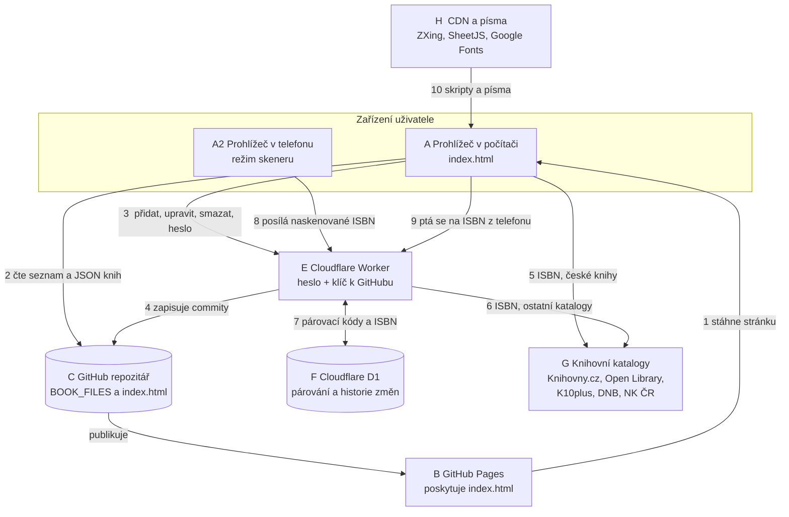
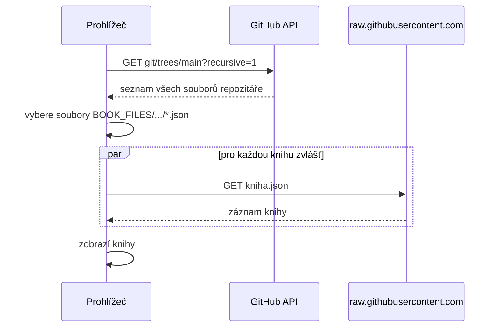
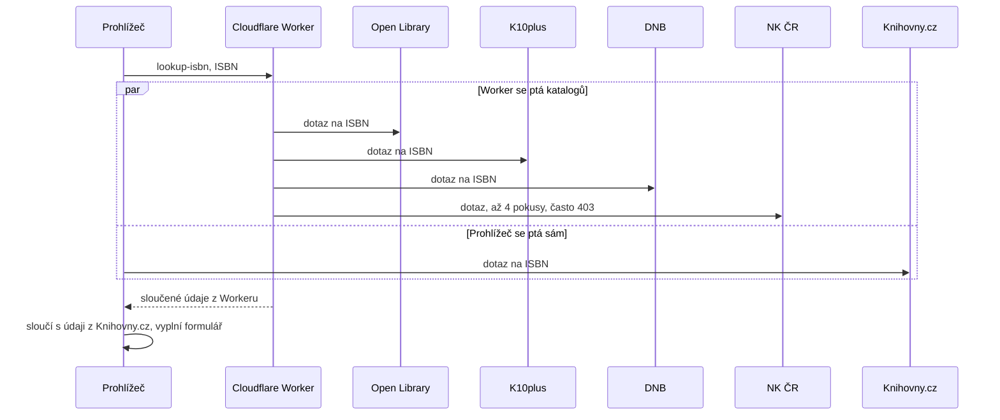
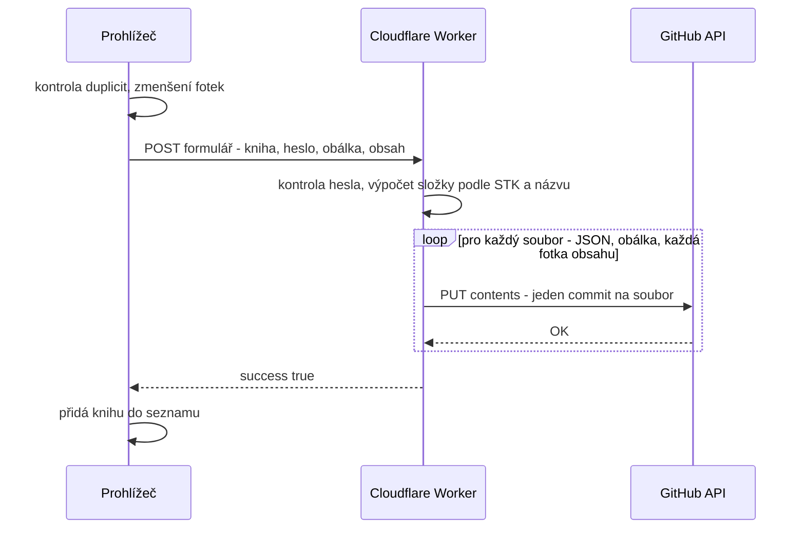
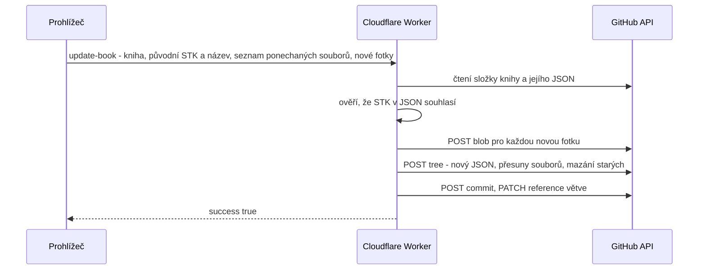
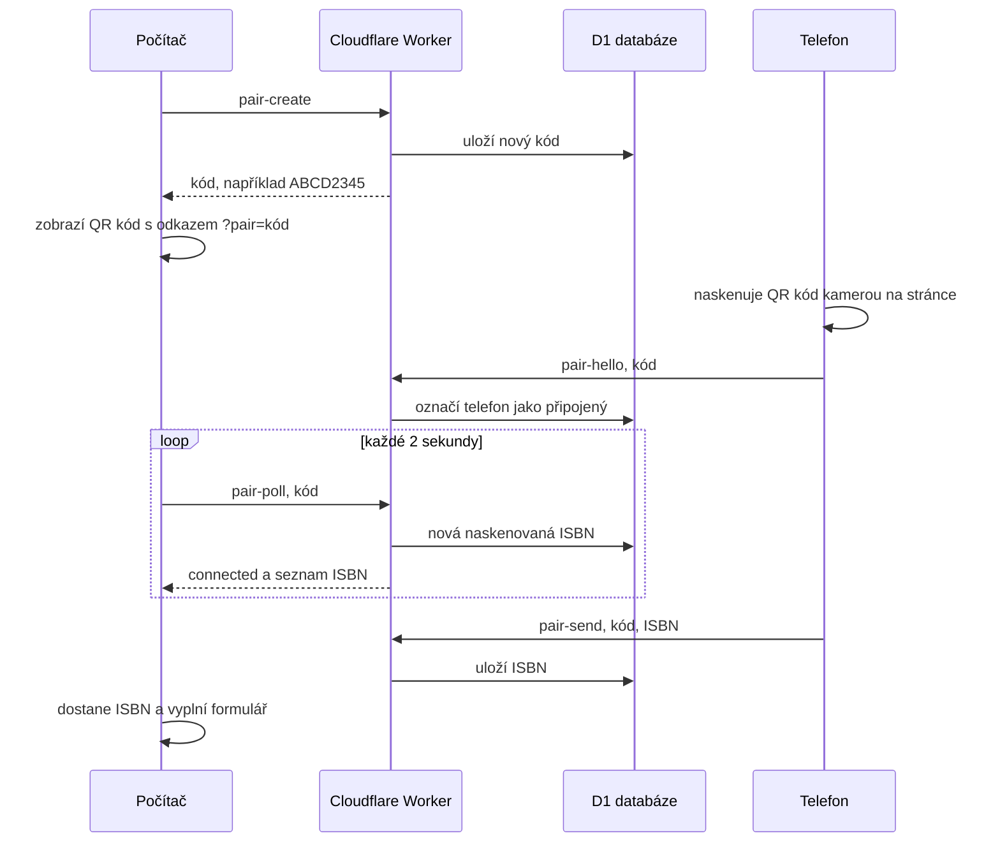
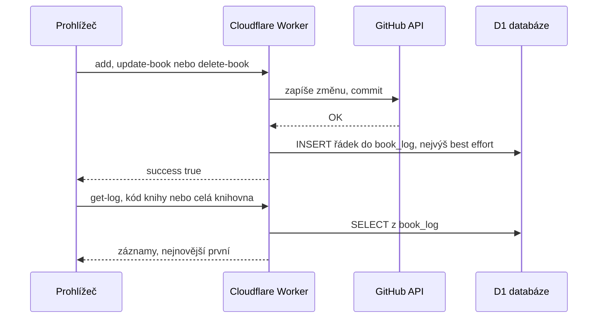

# Jak AK knihovna funguje – technický popis

Tento dokument popisuje **z čeho se projekt skládá a jak jsou jednotlivé části propojené**. Je psaný tak, aby se v něm vyznal i budoucí správce, který projekt nikdy neviděl.

> Stručný návod pro uživatele najdeš v [README](../README.md). Tady je to, co je „pod kapotou“.

## Obsah

1. [Součásti systému („krabičky“)](#1-součásti-systému-krabičky)
2. [Spojení mezi součástmi („šipky“)](#2-spojení-mezi-součástmi-šipky)
3. [Celkový diagram](#3-celkový-diagram)
4. [Postupy krok za krokem](#4-postupy-krok-za-krokem)
5. [Kde jsou uložená data](#5-kde-jsou-uložená-data)
6. [Bezpečnost: co je chráněno a co ne](#6-bezpečnost-co-je-chráněno-a-co-ne)
7. [Co se může pokazit a kde](#7-co-se-může-pokazit-a-kde)
8. [Použité technologie a externí služby](#8-použité-technologie-a-externí-služby)

---

## Princip v jedné větě

Webová stránka (`index.html`) je **jediná „aplikace“**, běží v prohlížeči a **čte knihy přímo z GitHubu**; kdykoli se má něco **změnit**, pošle požadavek **Cloudflare Workeru**, který má heslo a klíč k GitHubu a změnu za stránku zapíše.

---

## 1. Součásti systému („krabičky“)

| Č. | Součást | Kde běží | K čemu slouží | Co v sobě drží |
|---|---|---|---|---|
| **A** | **Prohlížeč s `index.html`** (v počítači) | zařízení uživatele | celé uživatelské rozhraní: hledání, formulář, skenování, statistiky | seznam knih v paměti, heslo po ověření (jen v paměti, do obnovení stránky) |
| **A2** | **Prohlížeč v telefonu** | telefon uživatele | tatáž stránka; v „režimu skeneru“ čte čárové kódy a posílá je počítači | spárovací kód v paměti |
| **B** | **GitHub Pages** | servery GitHubu | poskytuje soubor `index.html` na adrese `https://jemolotrab.github.io/AK-Database/` | – |
| **C** | **GitHub repozitář** `jemolotrab/AK-Database` | servery GitHubu | **databáze**: složka `BOOK_FILES/` s JSON soubory knih a fotkami; zároveň `index.html` a kód Workeru | všechny knihy, historie všech změn |
| **D** | **GitHub API** (`api.github.com`) | servery GitHubu | seznam souborů v repozitáři (čtení) a zápis commitů (Worker) | – |
| **E** | **Cloudflare Worker** (`worker.js`) | servery Cloudflare | jediné místo, které smí **zapisovat**: ověřuje heslo, zapisuje do GitHubu, hledá ISBN, zprostředkuje párování telefonu | tajné hodnoty: `ADD_BOOK_PASSWORD`, `GITHUB_TOKEN`; nastavení `GITHUB_REPO` |
| **F** | **Cloudflare D1** (databáze) | servery Cloudflare | krátkodobé uložení párovacích kódů a naskenovaných ISBN a trvalé uložení **historie změn** | tabulky `pair_sessions`, `pair_scans`, `book_log` |
| **G** | **Knihovní katalogy** | servery knihoven | zdroj údajů o knize podle ISBN | – (jen čteme) |
| | G1 Knihovny.cz | | české knihy; dotazuje se **prohlížeč** | |
| | G2 Open Library | | hlavně zahraniční knihy, popisy | |
| | G3 K10plus | | společný katalog německých knihoven | |
| | G4 DNB | | Německá národní knihovna | |
| | G5 Národní knihovna ČR | | česká národní bibliografie; **často blokuje** servery Cloudflare | |
| **H** | **Knihovny a písma z internetu (CDN)** | cdnjs, jsDelivr, Google Fonts | načítají se podle potřeby: ZXing (čtení kódů, QR), SheetJS (Excel), písma | – |

---

## 2. Spojení mezi součástmi („šipky“)

Čísla odpovídají diagramu v kapitole 3.

| Č. | Odkud → kam | Jak (protokol, adresa) | Co putuje | Ověření |
|---|---|---|---|---|
| **1** | B → A | HTTPS, stažení stránky | soubor `index.html` | žádné |
| **2** | C → A | **čtení**: `GET api.github.com/repos/…/git/trees/main?recursive=1`, pak pro každou knihu `GET raw.githubusercontent.com/…/kniha.json` | seznam souborů a JSON každé knihy; obrázky se načítají z `raw.githubusercontent.com` | žádné (repozitář je veřejný) |
| **3** | A → E | HTTPS `POST` na adresu Workeru, hlavička `X-Action` říká, co se má udělat (u přidání knihy chybí) | **heslo**, data knihy, fotky | heslo se porovná s tajnou hodnotou |
| **4** | E → D → C | HTTPS, GitHub API (Contents API a Git Data API) | zápis souborů, **commity** | `GITHUB_TOKEN` (uložen jen v Cloudflare) |
| **5** | A → G1 | HTTPS `GET`, Knihovny.cz API (VuFind) | ISBN → údaje o knize | žádné |
| **6** | E → G2–G5 | HTTPS `GET` | ISBN → údaje o knize | žádné |
| **7** | E ↔ F | vazba (binding) `DB` ve Workeru | párovací kódy, naskenovaná ISBN | jen Worker má přístup |
| **8** | A2 → E | HTTPS `POST` (`pair-hello`, `pair-send`) | spárovací kód a naskenované ISBN | znalost 8místného kódu |
| **9** | A → E | HTTPS `POST` (`pair-create`, `pair-poll`, každé 2 s) | počítač se ptá na nová ISBN od telefonu | znalost 8místného kódu |
| **10** | H → A, A2 | HTTPS, `<script>` a písma | ZXing, SheetJS, Google Fonts | žádné |

> **Proč se na české knihy ptá prohlížeč a ne Worker?** Národní knihovna ČR odmítá požadavky ze serverů Cloudflare (chyba 403) a Knihovny.cz je blokuje jako roboty (chyba 418). Prohlížeč návštěvníka ale projde, a Knihovny.cz navíc povoluje čtení z cizích stránek. Proto se dotaz na české knihy dělá přímo v prohlížeči (šipka 5), zatímco ostatní katalogy obstará Worker (šipka 6).

---

## 3. Celkový diagram

*Diagram jako obrázek (pro tisk nebo prohlížeče bez podpory Mermaid): [architektura.png](architektura.png), vektorově [architektura.svg](architektura.svg).*

---

## 4. Postupy krok za krokem

### 4.1 Načtení knihovny (nikdo se nepřihlašuje)

- Worker se při čtení **nepoužívá vůbec**. Knihovna se tedy zobrazí i při výpadku Cloudflare.
- GitHub omezuje dotazy na API (60 za hodinu z jedné IP adresy). Ve škole sdílí adresu hodně zařízení, proto se může stát, že se seznam ve špičce (když knihovnu používá hodně lidí najednou) nenačte.

### 4.2 Ověření hesla

Při kliknutí na „Chci přidat knihu!“, „Upravit“ nebo „Smazat“ stránka pošle Workeru `POST` s hlavičkou `X-Action: verify-password` a heslem. Worker odpoví `valid: true/false`. Heslo si stránka po úspěchu **pamatuje jen v paměti** (po obnovení stránky zmizí) a posílá ho s každou změnou znovu. **Worker heslo kontroluje u každé změny sám**, takže obejít okno s heslem v prohlížeči nestačí.

### 4.3 Vyplnění podle ISBN

- U českých ISBN (začínají `978-80`) mají přednost údaje z Knihovny.cz, u ostatních z Workeru. Pole, která jeden zdroj nemá, doplní druhý.
- Worker české ISBN před dotazem na NK ČR zapíše i s pomlčkami (její index je na pomlčky citlivý) a zkusí i desetimístný tvar.
- Čárový kód se čte v prohlížeči (vestavěný `BarcodeDetector`, jinak knihovna ZXing). Přijme se jen platné ISBN (978/979 + správná kontrolní číslice), které se **dvakrát po sobě** přečte stejně.

### 4.4 Přidání knihy

- Složka se určí z **kódu předmětu v STK** a z **názvu knihy**: `BOOK_FILES/<složka předmětu>/<název>/`.
- Každý soubor je v historii samostatný commit (`Přidána kniha: …`, `Obálka: …`, `Obsah: …`).
- Fotky se v prohlížeči před odesláním **zmenší** (obsah max. 2000 px, obálka 1200 px) a fotky obsahu se přejmenují na `obsah-1.jpg`, `obsah-2.jpg`…, aby se nepřepsaly.
- Kniha se do seznamu na stránce přidá až po potvrzení od Workeru. Ostatní návštěvníci ji uvidí po obnovení stránky.

### 4.5 Úprava knihy

- Celá úprava je **jeden commit**: nový JSON, nové fotky, přesun ponechaných souborů do nové složky (když se změnil název nebo předmět – bez opětovného nahrávání) a smazání toho, co z knihy zmizelo.
- Worker před úpravou **ověří, že složka opravdu patří této knize** (STK v JSON musí souhlasit) a že – pokud se složka mění – cílová složka ještě neexistuje.

### 4.6 Smazání knihy

Stránka nejdřív po zadání hesla vyžádá **opsání názvu knihy** (kopírování a vkládání je vypnuté). Pak pošle Workeru `delete-book` s STK a názvem; Worker ověří složku stejně jako při úpravě a smaže všechny její soubory **jedním commitem**. Starou verzi lze kdykoli vrátit z historie GitHubu.

### 4.7 Spárování telefonu s počítačem

- Kód má 8 znaků, platí 2 hodiny a v jednom párování lze poslat nejvýše 200 ISBN.
- Telefon posílá **jen čísla ISBN**. Nemůže nic uložit, upravit ani smazat.
- Počítač se ptá po 2 sekundách (tzv. *polling*), proto je mezi naskenováním a vyplněním krátké zpoždění.
- Když počítač založí **nové** párování, telefon s běžící kamerou stačí namířit na nový QR kód a připojí se sám.

### 4.8 Hledání knihy skenem

Ikonka 📷 ve vyhledávání spustí tutéž kameru, přečte ISBN a vloží ho do vyhledávacího pole. Hledání pak probíhá **jen v prohlížeči** nad už načteným seznamem – žádný server se neptá. ISBN-10 a ISBN-13 téže knihy se přitom považují za stejné.

### 4.9 Historie změn

- Po každém úspěšném **přidání, úpravě a smazání** zapíše Worker do tabulky `book_log` jeden řádek: kdy, co se stalo, název, STK a u úprav **seznam změněných údajů** (např. `Autor: Němcová → Božena Němcová`, `Obálka: vyměněna`, `Fotky obsahu: přidáno 2`). Porovnání provádí Worker, protože při úpravě už zná starou i novou verzi knihy.
- Kniha se v historii poznává podle **posledních čtyř písmen STK**. Ta se po celý život knihy nemění, i když se při úpravě změní předmět nebo kategorie (první části STK) nebo název. Historie jedné knihy je proto jen **filtr** téže tabulky, žádné samostatné záznamy pro každou knihu neexistují.
- Úprava, po níž se nic nezměnilo, se do historie nezapíše.
- Zápis do historie je **„best effort“**: když databáze chybí nebo selže, **uložení knihy se tím nepokazí**, jen k ní nebude záznam.
- Čtení historie (`get-log`) je veřejné a nevyžaduje heslo, protože ukazuje totéž, co veřejná historie commitů na GitHubu. Stránka zobrazuje 30 záznamů a další dotahuje tlačítkem „Načíst starší“.
- Historie zná jen změny provedené přes web a jen od chvíle, kdy byla zapnutá. Neví, **kdo** změnu provedl (jedno společné heslo).

### 4.10 Statistiky a Excel

Statistiky se počítají v prohlížeči z načtených knih. Při prvním stažení Excelu se z cdnjs dočte knihovna SheetJS, která v prohlížeči sestaví soubor `.xlsx` (listy **Knihy** a **Statistiky**) a nabídne ho ke stažení. Žádná data se nikam neposílají.

---

## 5. Kde jsou uložená data

| Co | Kde | Poznámka |
|---|---|---|
| Záznam knihy (`<název>.json`) | repozitář, `BOOK_FILES/<předmět>/<název>/` | pole: `stk`, `title`, `author`, `isbn`, `year`, `description`, `location`, `keywords`, `matura`, `cover`, `contents`, `added`, `updated` |
| Obálka a fotky obsahu | stejná složka | `obsah-1.jpg`, `obsah-2.jpg`… |
| Historie všech změn | git (GitHub) | umožňuje vrátit smazanou nebo špatně upravenou knihu |
| Heslo pro editor | Cloudflare, tajná hodnota `ADD_BOOK_PASSWORD` | **není** v repozitáři |
| Klíč k GitHubu | Cloudflare, tajná hodnota `GITHUB_TOKEN` | **není** v repozitáři; vyprší (nejdéle po roce) |
| Párovací kódy a naskenovaná ISBN | Cloudflare D1, tabulky `pair_sessions` a `pair_scans` | mažou se po 2 hodinách |
| Historie změn | Cloudflare D1, tabulka `book_log` | trvalá; řádek = jedna akce (přidání, úprava, smazání) |
| Heslo po ověření, seznam knih, spárovací kód | paměť prohlížeče | zmizí po obnovení stránky |

Do systému se **neukládají žádné osobní údaje** (žádní čtenáři, žádné půjčování), jen údaje o knihách.

---

## 6. Bezpečnost: co je chráněno a co ne

**Co funguje dobře**

- Klíč k GitHubu a heslo jsou jen v Cloudflare. Nikdo je nevyčte ze stránky ani z repozitáře.
- Každá **změna** vyžaduje heslo a Worker ho ověřuje **sám** u každého požadavku.
- Při **úpravě a mazání** Worker kontroluje vstupy: tvar STK, nepovolené znaky v názvech (lomítka, `..`), a ověří, že složka patří dané knize. Špatná hodnota tedy nemůže smazat nebo přepsat cizí složku. (Při přidání knihy hlídá název formulář na stránce.)
- Smazání i úprava jsou commity, takže jdou **vrátit**.
- Klíč k GitHubu by měl mít oprávnění jen k tomuto jednomu repozitáři (viz README, kapitola Nastavení).

**Upřímně: slabá místa**

- **Hádání hesla není omezené.** Worker nepočítá neúspěšné pokusy, takže by šlo heslo zkoušet automaticky. Doporučení: dlouhé heslo; do budoucna omezit počet pokusů.
- **Worker odpovídá komukoli** (hlavička `Access-Control-Allow-Origin: *`). Změny chrání heslo, ale vyhledávání ISBN a párování může použít kdokoli, kdo zná adresu Workeru. Dopad je malý (jde jen o veřejné údaje o knihách a čísla ISBN).
- **Potvrzení smazání opsáním názvu je jen v prohlížeči.** Chrání před nehodou, ne před člověkem, který zná heslo a posílá požadavky ručně.
- **Data jsou veřejná.** Aby je prohlížeč mohl číst z GitHubu bez přihlášení, musí být repozitář veřejný.
- **Data „přidáno“ a „upraveno“** zapisuje hodiny zařízení, které knihu ukládá. Špatně nastavený čas = špatné datum.
- **Jedno společné heslo.** Neví se, kdo změnu provedl (historie změn ukáže jen co a kdy). Historie také nezachytí změny provedené přímo na GitHubu.

---

## 7. Co se může pokazit a kde

| Šipka / část | Co může selhat | Projev | Řešení |
|---|---|---|---|
| 2 (čtení z GitHubu) | výpadek, limit 60 dotazů za hodinu | „Chyba při načítání knih.“ | počkat, obnovit stránku |
| 3 (stránka → Worker) | výpadek internetu nebo Cloudflare | ❌ „Chyba připojení“ | zkusit znovu; **zadaná data se ztratí** |
| 3 (heslo) | špatné heslo, Worker po změně hesla znovu nenasazen | ❌ „Unauthorized“ | zkontrolovat `ADD_BOOK_PASSWORD`, **Deploy** |
| 4 (Worker → GitHub) | vypršel nebo chybí klíč, špatný `GITHUB_REPO` | ❌ „GitHub 401/403/404“ | nový klíč s oprávněním *Contents: Read and write*, opravit nastavení |
| 4 (konflikt) | dva lidé ukládají současně | ❌ chyba GitHubu | zopakovat uložení |
| 5 / 6 (katalogy) | katalog neodpovídá nebo kniha v něm není | „Kniha nenalezena“ | vyplnit ručně |
| 6 (NK ČR) | blokace serverů Cloudflare | v ladicích údajích 403 | očekávané, proto se české knihy ptá prohlížeč |
| 7 (D1) | databáze není připojena jako `DB` | „Párování telefonu není nastavené“, „Historie změn není zapnutá“ | vytvořit D1, spustit `database.sql`, přidat vazbu `DB` |
| 7 (D1) | v databázi chybí tabulka historie | „Tabulka historie neexistuje“ (ukládání knih funguje dál) | znovu spustit `database.sql` |
| 8 / 9 (párování) | kód vypršel (2 h) nebo počítač založil nové párování | telefon hlásí, že spojení skončilo | naskenovat nový QR kód |
| kamera | stránka není na `https://`, zakázané oprávnění | kamera se nespustí | povolit kameru v prohlížeči |

---

## 8. Použité technologie a externí služby

| Oblast | Co se používá |
|---|---|
| Web | jeden soubor `index.html` (HTML, CSS, JavaScript bez frameworku) |
| Hosting webu a dat | GitHub Pages a GitHub repozitář |
| Server | Cloudflare Workers (JavaScript) |
| Databáze (párování, historie změn) | Cloudflare D1 (SQLite) |
| Zápis do GitHubu | GitHub Contents API (přidání) a Git Data API (úprava, smazání jedním commitem) |
| Údaje o knihách | Knihovny.cz (VuFind API), Open Library, K10plus a DNB (SRU / MARC), NK ČR (Aleph) |
| Čtení čárových kódů a QR | `BarcodeDetector` v prohlížeči, jinak ZXing (jsDelivr) |
| Excel | SheetJS (cdnjs) |
| Písma | Google Fonts |
